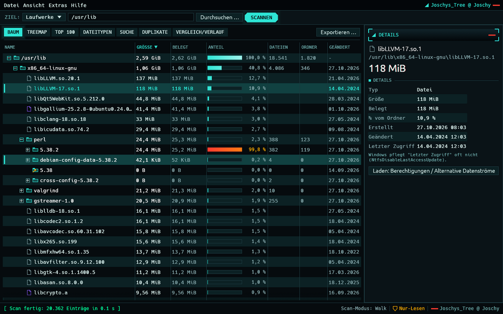
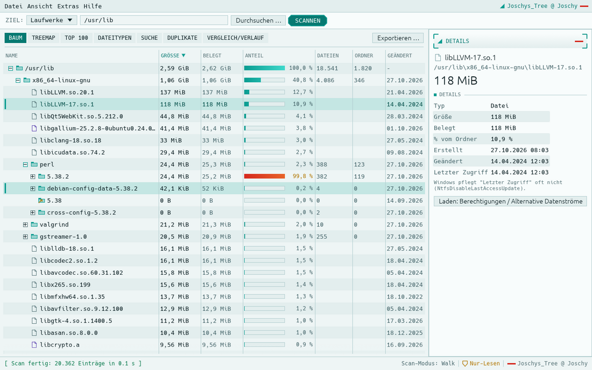
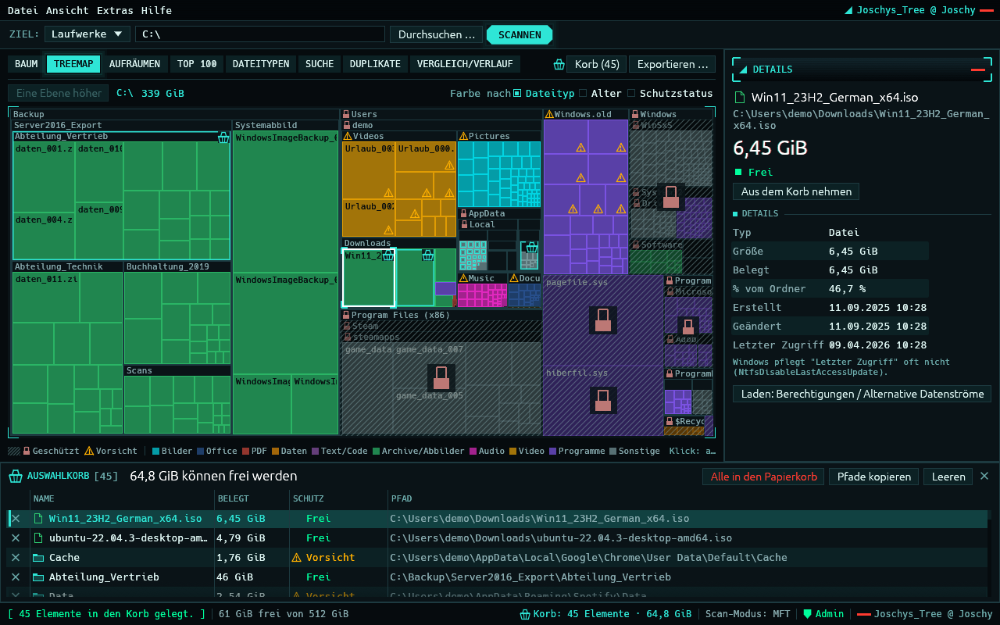
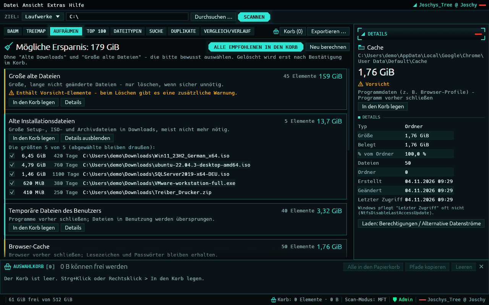

<!-- Joschys_Tree – README – @ Joschy -->
# Joschys_Tree

Schneller, portabler Festplatten-Analyzer für Windows (Vorbilder: WizTree und TreeSize Pro). Eine einzelne `JoschysTree.exe`, geschrieben in Rust mit egui/eframe, nur GUI, ohne Installation.

## Download

**[Neueste Version laden (GitHub Releases)](https://github.com/jr-stack-bot/joschys_tree/releases/latest)**

- Datei `JoschysTree.exe` laden, keine Installation nötig.
- **SmartScreen:** Die exe ist nicht signiert, Windows kann warnen. Dann "Weitere Informationen → Trotzdem ausführen".
- **Prüfsumme prüfen** (optional): `JoschysTree.exe.sha256` aus dem Release laden und mit dieser PowerShell-Ausgabe vergleichen:
  `Get-FileHash .\JoschysTree.exe -Algorithm SHA256`
  Hinweis: `Get-FileHash` gibt den Hash in Großbuchstaben aus, die `.sha256`-Datei enthält ihn in Kleinbuchstaben. Verglichen wird ohne Beachtung der Groß-/Kleinschreibung, z. B. `(Get-FileHash .\JoschysTree.exe -Algorithm SHA256).Hash -eq (Get-Content .\JoschysTree.exe.sha256).Split(' ')[0]` (PowerShell `-eq` ignoriert Groß-/Kleinschreibung).
- **Administrator:** Nur mit Adminrechten gibt es den MFT-Schnellscan und das Löschen, sonst Nur-Lese-Modus.

Warum Releases? Actions-Artefakte lädt GitHub nur eingeloggten Nutzern aus, Release-Dateien sind dagegen für jeden ohne Login herunterladbar.

## Screenshots

Baumansicht, dunkles Design (Standard):

Baumansicht, helles Design:

Treemap mit Windows-Schutz (Schloss und Schraffur = geschützt, Warndreieck = Vorsicht) und Auswahlkorb unten:

Aufräum-Assistent:

Aufgenommen unter Linux (Baum- und Hell-Ansicht: Scan von `/usr/lib`; Treemap und Aufräumen: künstlicher Demo-Baum mit Windows-Pfaden), daher Ersatzschriften; unter Windows erscheinen Consolas und Bahnschrift.

## Funktionen

**Kern**
- Schneller Scan von Laufwerken und Netzfreigaben (lokal NTFS: MFT-Schnellscan, sonst paralleler Verzeichnis-Scan)
- Baumansicht mit Größe, belegtem Speicher, Dateizahl, Prozent und Datum
- Treemap-Ansicht: Klick wählt aus, Doppelklick zoomt hinein, Strg+Klick legt in den Korb, Rechtsklick öffnet das Menü; anklickbare Pfadleiste; Farbe nach Dateityp, Alter oder Schutzstatus
- Top 100 der größten Dateien
- Dateitypen-Statistik
- Suche mit Filtern (Name/Glob, Größe, Alter, Endung)
- Export als CSV, XLSX, HTML und PDF

**Erweitert**
- Aufräum-Assistent: findet Temp-Dateien, Browser-Cache, Absturzberichte, alte Installationsdateien und Downloads, große alte Dateien und leere Ordner, zeigt die mögliche Ersparnis und legt Kandidaten in den Auswahlkorb
- Windows-Schutz (geschützte Dateien lassen sich nicht löschen): Schloss-Symbol und Schraffur für gesperrte, Warndreieck für Vorsicht-Elemente, Begründung im Tooltip
- Auswahlkorb: Elemente aus allen Ansichten sammeln (ohne Doppelzählung), Summe "kann frei werden", alles in einem Schritt in den Papierkorb
- Tastatur: Entf = in den Korb, Rücktaste = Treemap eine Ebene höher, Strg+B = Korb ein-/ausklappen, Esc = Auswahl aufheben
- Duplikat-Suche (Größe, Teil-Hash, Voll-Hash)
- Snapshots speichern (`.jtscan`), Delta-Vergleich und Wachstumsverlauf
- Detailpanel mit Besitzer, Zugriffsrechten (ACL) und alternativen Datenströmen (ADS)
- Lange Pfade (über 260 Zeichen), Reparse-Points werden nicht verfolgt
- Dunkles und helles Design, Deutsch und Englisch

## Administrator oder nicht

- **Mit Administratorrechten:** MFT-Schnellscan auf lokalen NTFS-Laufwerken und Löschen (Papierkorb oder endgültig, mit zweistufiger Bestätigung).
- **Ohne Administratorrechte:** Nur-Lese-Modus mit Verzeichnis-Scan, keine Lösch-Menüpunkte. Die Fußzeile zeigt den Modus an.
- Netzfreigaben, FAT32/exFAT und Fehlerfälle fallen automatisch auf den Verzeichnis-Scan zurück.
- Gelöscht werden kann nur in einem frischen Scan dieses Rechners, nie in einem geladenen Snapshot (`.jtscan`).
- "In den Papierkorb" löscht nie endgültig: Laufwerke ohne Papierkorb (Netzfreigaben, USB-Sticks) melden einen Hinweis, dann bleibt nur "Endgültig löschen" mit zweiter Bestätigung.

## Sicher aufräumen

Jedes Element bekommt eine Schutzstufe; gelöscht wird nur über den Papierkorb bzw. mit Bestätigung, und der Löschweg prüft die Stufe noch einmal selbst:

- **Gesperrt:** Windows-Ordner, Programme (`Program Files`), `ProgramData\Microsoft`, Laufwerkswurzeln, `pagefile.sys`/`hiberfil.sys`/`$Recycle.Bin`, Benutzerprofile selbst, `NTUSER.DAT` und alles mit System-Attribut – nie löschbar, auch nicht als Teil eines Ordners. Ebenso 8.3-Kurznamen wie `PROGRA~1` auf jeder Pfadebene (bewusst streng, das trifft auch harmlose Namen wie `ABC~1.tmp`) und Systemordner auf Netzfreigaben (`\\pc\C\Windows`).
- **Aufgelöste Pfade:** Geprüft wird nicht nur der Pfadtext, sondern auch der echte Ort – ein subst- oder Netzlaufwerk (`X:` = `C:\`, `Z:` = `\\server\c$`) oder eine Junction im Elternordner kann nicht am Schutz vorbei führen; die strengere Stufe gilt. Lässt sich der echte Ort eines vorhandenen Elements nicht ermitteln, ist es gesperrt.
- **Vorsicht:** `AppData`-Inhalte (Browser, Programme), Dokumente/Bilder/OneDrive, `Windows.old`, Programmdaten in `ProgramData`, versteckte Dateien, Verknüpfungen – löschbar nach roter Warnung und Häkchen "Ich weiß, was ich tue".
- **Frei:** alles andere, z. B. Temp-Inhalte, Downloads, eigene Daten- und Backup-Ordner.
- **"Alle empfohlenen in den Korb"** nimmt nur temporäre Benutzerdateien, Browser-Cache, Absturzberichte und leere Ordner mit. Große Temp-Dateien (nur `.tmp`/`.chk`/`.dmp`), Installer (`.iso`/`.msi`/`.exe` …), alte Downloads und große alte Dateien legt man bewusst einzeln in den Korb.
- **Backups und Archive werden nie automatisch empfohlen:** `.bak`/`.old`/`.log` zählen nicht als Temp-Dateien und `.zip`/`.7z`/`.rar` nicht als Installer; sie können höchstens in den nicht empfohlenen Gruppen "Alte Downloads" oder "Große alte Dateien" auftauchen. VM-Abbilder (`.vhdx`, `.vmdk` …), Outlook-Postfächer, Datenbanken, Passwort-Tresore, Systemabbilder, `.bak` sowie Dateien in `steamapps`- und `DockerDesktop`-Ordnern erscheinen nie unter "Große alte Dateien"; OneDrive-Dateien "nur online" schlägt der Assistent in keiner Gruppe vor (Löschen würde auch in der Cloud löschen). Absturzberichte sind nur die Dateien in `AppData\Local\CrashDumps`.
- Info statt Löschen: Ruhezustand, Auslagerungsdatei, `Windows.old` und Papierkorb zeigt der Aufräum-Assistent nur mit Hinweis auf das passende Windows-Werkzeug.
- Löschen nur als Administrator in einem frischen Scan; geladene Snapshots bleiben schreibgeschützt.

## Bekannte Einschränkungen

- Hardlinks: Der Verzeichnis-Scan (Walk) zählt eine Datei mit mehreren Hardlinks mehrfach, der MFT-Scan nur einmal (erster Name). Die Summen beider Scan-Arten können daher abweichen.

Bauen aus dem Quelltext: siehe [BUILD.md](BUILD.md).

## Lizenz

GNU Affero General Public License v3.0 oder später (AGPL-3.0-or-later), Volltext in [LICENSE](LICENSE).

## English

Joschys_Tree is a fast, portable disk space analyzer for Windows (in the spirit of WizTree and TreeSize Pro): a single GUI executable written in Rust. With administrator rights it uses the MFT fast scan on local NTFS volumes and enables deleting; without admin rights it runs read-only with a regular directory scan. The exe is unsigned, so SmartScreen may warn. Download the exe from [GitHub Releases](https://github.com/jr-stack-bot/joschys_tree/releases/latest) (no login needed). Licensed under AGPL-3.0-or-later. Build instructions: see [BUILD.md](BUILD.md).

---
Joschys_Tree @ Joschy
